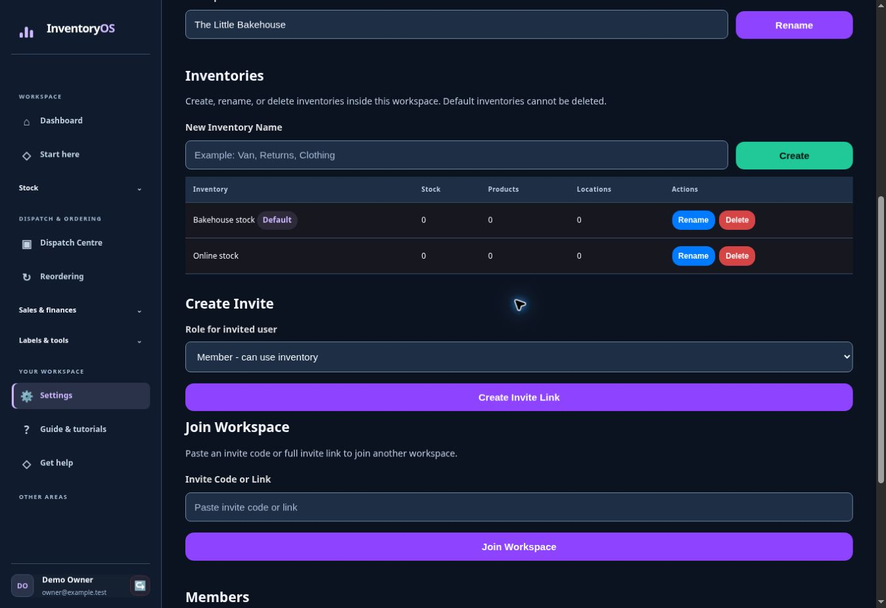

# Work together in a shared workspace

Pro includes shared team inventories, member accounts, workspace roles and permissions, and owner and admin controls.

## Invite a teammate

1. Select the workspace from the top bar.
2. Open **Settings → Manage Workspace Members**.
3. Create an invite or invite link, choose the intended role, and share it with the teammate.
4. After they join, check that they can see the correct workspace and inventory. Review the member list before changing or removing access.

## Choose access carefully

Workspace permissions determine who can make changes. Give each person the role needed for their work and remove access when it is no longer needed. An account's workspace role and the separate InventoryOS owner-only Admin Portal are different controls.

## Keep daily work clear

Use the workspace and inventory selectors before stock changes. The pick list and saved product barcodes help several people handle the same physical inventory consistently.

Next: return to [the first stock workflow](../free/README.md) for an end-to-end refresher.
