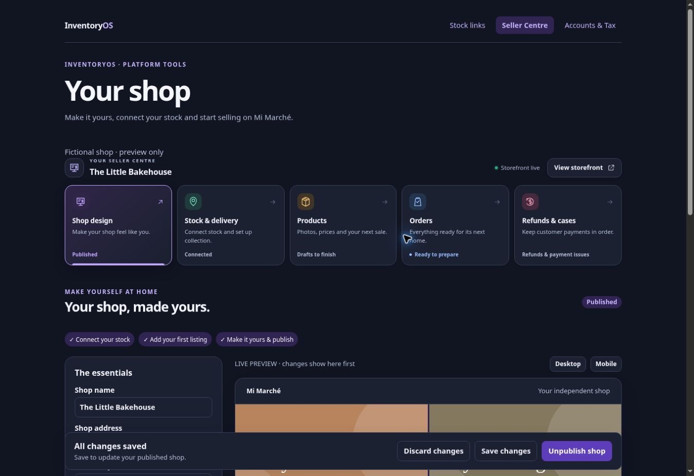
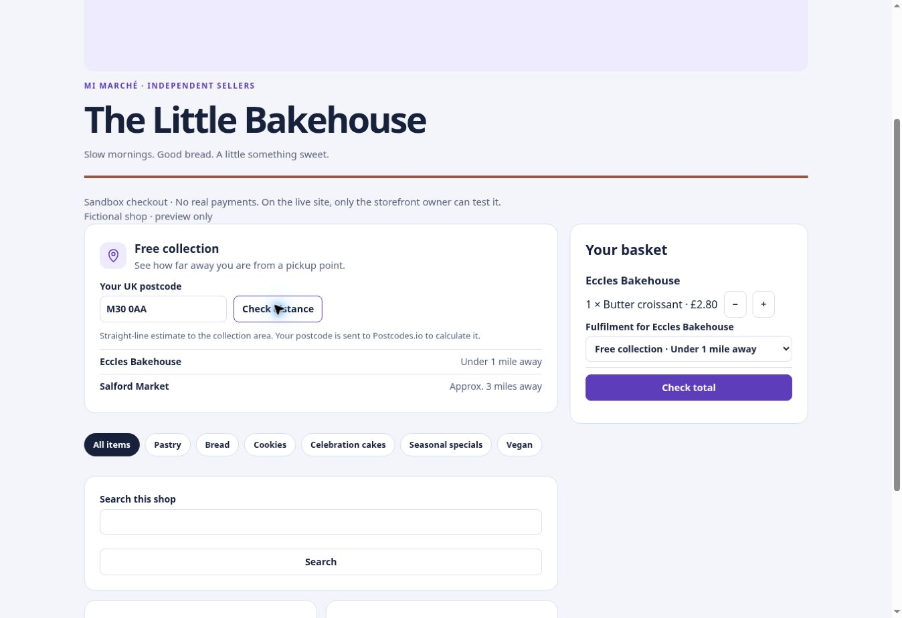

# Set up a Mi Marché storefront

Open [Seller Centre](https://app.inventoryos.co.uk/platform/?view=seller) to prepare a branded shop linked to eligible InventoryOS stock.

1. In **Shop design**, name your shop, add your banner images and choose quick filters. Check the desktop and mobile previews before saving.
2. In **Stock & delivery**, connect each branch to the correct inventory and set collection or delivery options.
3. In **Products**, add photos, prices and categories. Check any listings flagged for review before publishing.
4. Once the storefront is published, select **View storefront** to see the customer page.

## Show a free collection estimate

In **Stock & delivery**, edit a branch and enable **Free collection**. Save its pickup address and, optionally, a postcode area. Customers can enter a UK postcode on the storefront to see an approximate straight-line distance and choose collection in the basket. The pickup address is shown after payment.

Paid checkout depends on marketplace availability and the seller’s payment setup. Use the storefront preview to check the shop and its collection options.
