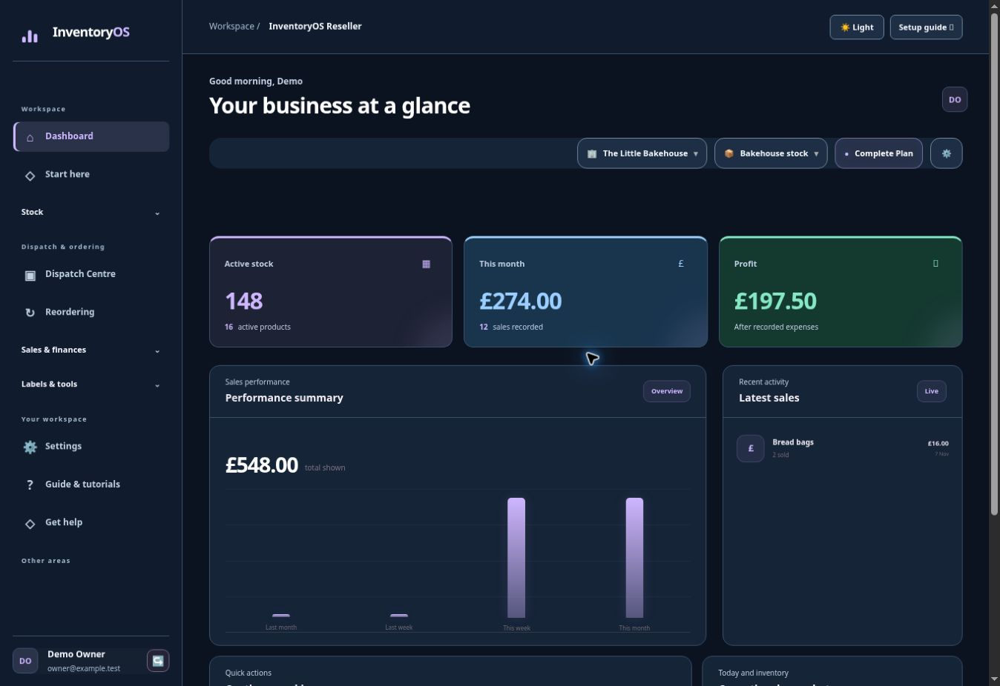
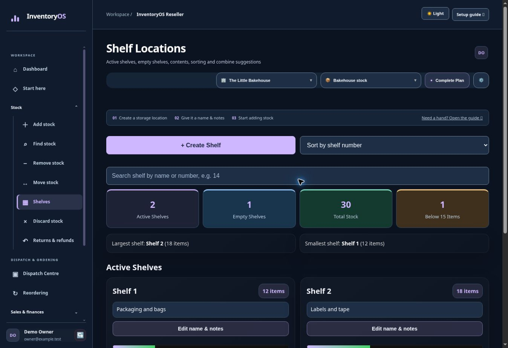

# Free: first stock workflow

The Free plan includes up to **100 active stock items**, one personal workspace, core stock movements, dashboard figures, and basic stale-stock reporting.

## 1. Read the dashboard

Open **Dashboard** from the left menu. The cards show active stock and sales figures; recent activity helps you check what changed. Use the top selectors to confirm you are in the intended workspace and inventory before entering stock.

**Find it:** left menu → **Dashboard**. **Check:** the workspace and inventory names at the top before adding or removing anything.

## 2. Create a location

Open **Locations** under **Stock**. The page may be called **Boxes** or **Shelves**, depending on your workspace. Use **Create Box** or **Create Shelf** to name a location or take the next available number. Check the active and empty location lists to see where stock is stored.

**Find it:** left menu → **Stock → Locations**. A location name you type explicitly remains that saved name. Complete lets you change how numeric locations are labelled.

## 3. Add one item

See [Add and find stock](add-and-find.md). Start with a quantity of one so you can follow it through search, movement, and removal.

## 4. Keep stock accurate

See [Move, remove and check stock](manage-stock.md). If an item is broken or lost, choose **Discard Stock** rather than recording a sale.
