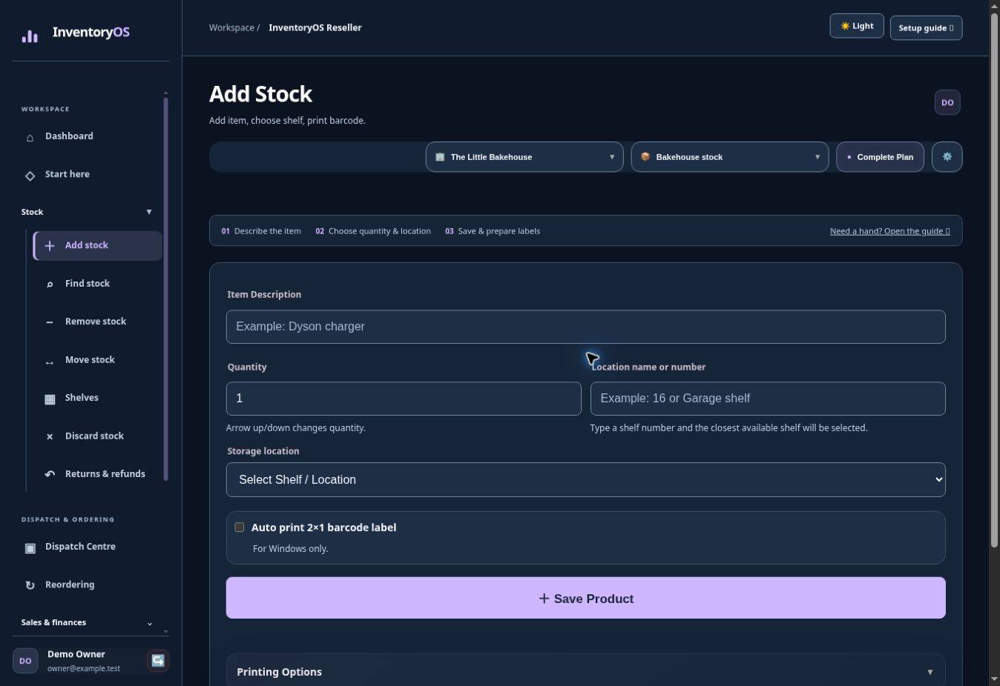
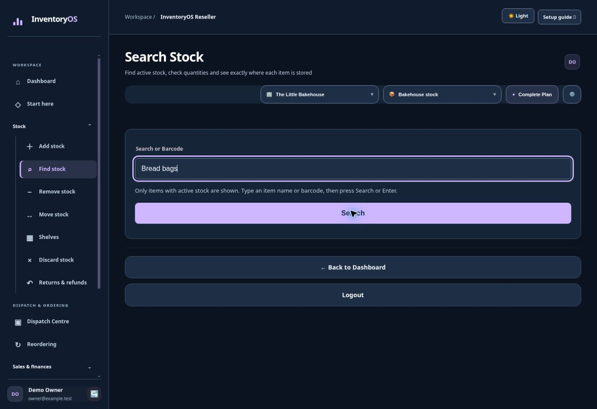

# Add and find stock

## Add a product

1. Open **Add Stock**.
2. In **Item Description**, type a clear name. If InventoryOS offers an existing product, select it to add to that product's stock.
3. Enter the **Quantity** and choose the location number.
4. Select **Save Product**. Search for the item afterwards to confirm the location and quantity.

**Look for:** the description field near the top, quantity and location side by side, and the **Save Product** button. The **Printing Options** area is for label features available on eligible paid plans.

## Find the same product

Open **Search Stock**, type part of the description or scan its barcode, then select **Search**. The result shows the saved barcode and the quantities at each location.

**Tip:** if the item appears in more than one location, read the quantities under each location before moving or removing stock.
