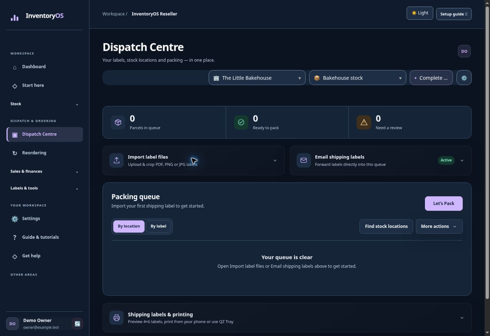
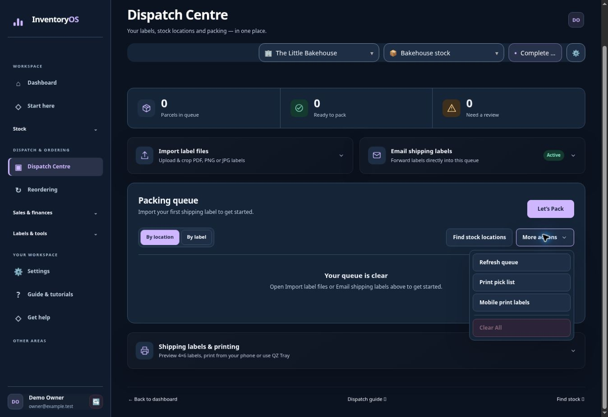

# Packing and shipping labels

**Find it:** left menu → **Dispatch Centre**. Starter and Complete include file uploads and supported 4×6 cropping. Complete also includes a workspace address for forwarding supported label attachments.

## Add labels to the packing queue

1. Open **Import label files** and choose PDF, PNG or JPEG files.
2. Select **Preview crop**. Check that every address and barcode fits the 4×6 preview.
3. Select **Add to queue** when the crops are ready.

## Find the stock and print

1. In **Packing queue**, choose **Find stock locations**. Review matches before picking.
2. Choose **By location** for a grouped pick run or **By label** to follow the label order.
3. Open **More actions** for **Print pick list** or **Mobile print labels**. Open **Shipping labels & printing** to check 4×6 previews and use **Mobile print / PDF** or **Print via QZ Tray** when available.
4. Use **Let’s Pack** to check the parcel against its label. The dispatch workflow does not itself remove items from inventory.

